# My Company

[](LICENSE)

**Công ty ảo chạy bằng Claude Code: bạn giao việc, một đội nhân viên AI làm, bạn duyệt rồi mới lấy kết quả.**


*Văn phòng 3D chạy thật: nhân viên đi đọc code ở thư viện, vào phòng server chạy lệnh, giấy bay giữa các bàn khi việc được giao và nộp. (Ảnh chụp với Claude giả để minh họa mà không tốn hạn mức.)*

**Mục lục:** [1. Sản phẩm](#1-sản-phẩm) · [2. Mô tả](#2-mô-tả-sản-phẩm) · [3. Cách hoạt động](#3-cách-hoạt-động) · [4. Hướng dẫn cài đặt](#4-hướng-dẫn-cài-đặt) · [Tài liệu chi tiết](docs/HUONG-DAN-CHI-TIET.md)

---

## 1. Sản phẩm

**Tên: My Company** (lệnh chạy: `my-company`).

Một ứng dụng web chạy trên máy của bạn, biến Claude Code thành một công ty phần mềm thu nhỏ có Giám đốc, Trưởng nhóm và nhân viên, kèm một **văn phòng 3D** để bạn nhìn thấy ai đang làm gì.


*Văn phòng 3D isometric (có nút chuyển sang 2D pixel art). Mỗi chấm màu trên bàn là một trạng thái: đang làm, chờ duyệt bài, quá tải, vừa lỗi, chờ bạn quyết.*

## 2. Mô tả sản phẩm

**Vấn đề:** dùng Claude Code cho việc lớn thì bạn phải ngồi canh từng phiên, tự chia việc, tự kiểm tra, và khó giao nhiều việc song song mà không rối.

**My Company giải quyết bằng cách tổ chức Claude thành công ty:**

- **Giao việc theo ba cỡ.** *Việc lẻ* cho một nhân viên; *việc lớn* cho cả một team (Trưởng nhóm chia việc, duyệt bài, gộp nhánh); *yêu cầu cho cả công ty* (Giám đốc chốt "hợp đồng" chung giữa các team rồi chia việc).
- **Làm song song, không giẫm chân nhau.** Mỗi nhân viên một tiến trình `claude -p` với vai trò, model và skill riêng, làm trong **nhánh git riêng**.
- **Bạn luôn là người quyết.** Hai điểm dừng bắt buộc: duyệt kế hoạch trước khi làm, duyệt kết quả trước khi lấy. **Không có gì được push lên git.**
- **Chạy bằng gói Claude Pro, không cần khóa API.** Hết hạn mức thì cả công ty nghỉ, hồi lại thì tự làm tiếp.
- **Nhìn thấy công ty làm việc.** Văn phòng 3D/2D, bảng kanban, tải của từng team, nhật ký hội thoại, báo cáo tuần, duyệt việc từ điện thoại.
- **Xử lý khi lỗi.** Việc lỗi có chẩn đoán rõ nguyên nhân và các phương án cứu (làm tiếp, nâng model, làm lại, nhận phần đã làm).

**Dành cho:** lập trình viên (hoặc người làm sản phẩm) có một dự án git và một tài khoản Claude Pro, muốn giao việc cho AI theo kiểu "quản lý một đội" thay vì "ngồi cạnh một trợ lý".

**Công ty gồm 8 team gửi kèm** (sửa hoặc thêm team bằng file Markdown trong `teams/`, không cần sửa code): Ban giám đốc, Backend, Frontend, Chất lượng (QA), DevOps, Thiết kế UI/UX, Bảo mật, Báo cáo; tổng 20 nhân viên (tầng 1 chỉ đủ chỗ cho sáu team, team thứ bảy ngồi tầng 2).

## 3. Cách hoạt động

### Luồng một yêu cầu

```mermaid
flowchart LR
    A([Bạn giao việc]) --> B[Giám đốc đọc code<br/>chốt hợp đồng chung<br/>chia việc cho các team]
    B --> C{{Điểm dừng 1<br/>Bạn duyệt kế hoạch}}
    C -->|Duyệt| D[Trưởng nhóm chia việc con<br/>cho nhân viên]
    C -->|Từ chối + nhận xét| B
    D --> E[Nhân viên làm song song<br/>mỗi người một nhánh git]
    E --> F[Trưởng nhóm duyệt bài<br/>hoặc trả lại làm tiếp]
    F --> G[Gộp nhánh các team<br/>vào company/epic N]
    G --> H[Giám đốc đọc code,<br/>chạy test, báo cáo]
    H --> I{{Điểm dừng 2<br/>Bạn duyệt kết quả}}
    I -->|Duyệt| J([Bấm Đưa vào dự án<br/>git merge --no-ff])
```



Ba cỡ việc dùng cùng khung này, chỉ khác điểm bắt đầu: *việc lẻ* bỏ qua Giám đốc và Trưởng nhóm; *việc lớn* bắt đầu từ Trưởng nhóm; *yêu cầu* bắt đầu từ Giám đốc.

| 1. Giao yêu cầu | 2. Duyệt kế hoạch (điểm dừng 1) | 3. Duyệt kết quả (điểm dừng 2) |
|---|---|---|
|  |  |  |

### Ba tầng nhân sự

| Tầng | Quyền | Làm gì |
|---|---|---|
| **Giám đốc** | Chỉ đọc | Chốt hợp đồng chung (đường dẫn API, dữ liệu vào ra, mã lỗi), chia yêu cầu cho các team, kiểm tra kết quả đã ghép |
| **Trưởng nhóm** | Chỉ đọc | Xem tải của từng người, chia việc con (không chồng lấn file), duyệt hoặc trả bài |
| **Nhân viên** | Sửa code trong phạm vi team | Làm việc con trong worktree riêng, có thể hỏi Trưởng nhóm, đồng nghiệp hoặc chính bạn khi vướng thật |

Mỗi nhân viên làm tối đa 1 việc và giữ 2 việc chờ; tối đa 2 tiến trình `claude` chạy cùng lúc (đổi bằng `COMPANY_MAX_CONCURRENT`).

### Cơ chế bên dưới

- **Mỗi việc một worktree và một nhánh git** (`company/<tên>-task<số>`), đặt ở thư mục anh em `<tên-dự-án>-worktrees/`. Công cụ tự commit khi xong. Code bạn đang viết dở không bị đụng tới.
- **Một nhân viên = một tiến trình `claude -p`** với model, mức suy luận, công cụ và skill theo file vai trò trong `teams/`. Việc lỗi giữa chừng được tiếp tục bằng `--resume` (giữ nguyên phiên cũ).
- **Giao tiếp qua MCP của công ty.** Giám đốc, Trưởng nhóm và nhân viên gọi công cụ như `assign_to_member`, `approve`, `reject`, `ask_lead`, `ask_owner`. Máy chủ ép luật (giới hạn tải, số lần hỏi, không chồng lấn phạm vi).
- **Chọn model theo độ khó.** Một lần gọi `haiku` nhỏ đánh giá độ khó rồi chọn model: đơn giản dùng `haiku`, bình thường theo vai trò, khó dùng `opus`. Việc hết lượt mà chưa xong tự nâng một bậc.
- **Hạn mức Pro:** đọc từ sự kiện `rate_limit_event` của Claude; hết thì lưu việc dở, cả công ty nghỉ, tới giờ hồi thì tự làm tiếp. Công cụ gỡ `ANTHROPIC_API_KEY` khỏi mọi tiến trình con nên không bao giờ tính tiền API.
- **Văn phòng 3D phản ánh dữ liệu thật.** Mô phỏng lấy trạng thái việc qua WebSocket (ai đọc code thì ra thư viện, ai chạy lệnh thì vào phòng server, giấy bay khi giao việc, nộp bài, trả bài).

### An toàn

- **Không bao giờ push.** Việc đưa vào dự án chỉ xảy ra khi bạn bấm **Đưa vào dự án**, và hệ thống từ chối nếu thư mục dự án đang có file sửa dở hoặc gộp sẽ xung đột.
- **Chặn cứng bằng hook** (`server/path-guard.mjs`): nhân viên không đọc hay sửa được `.env`, `.git`, file ngoài worktree; chỉ sửa trong thư mục của team (`folders` trong hồ sơ dự án).
- **Chỉ chạy lệnh được cho phép:** lệnh Bash nào không nằm trong `allowed_commands` của hồ sơ dự án thì bị từ chối.
- **Chỉ nghe ở `127.0.0.1`**, từ chối `Host`/`Origin` lạ. Truy cập từ xa (điện thoại) đi qua Tailscale và phải có PIN.
- **Skill phải được duyệt:** chỉ skill ghi trong `skills.lock` (kèm mã băm) mới được nạp; sửa nội dung sau khi duyệt thì bị từ chối.

Chi tiết từng cơ chế, bảng trạng thái văn phòng, xử lý lỗi, thi đấu skill... xem **[Hướng dẫn chi tiết](docs/HUONG-DAN-CHI-TIET.md)**.

## 4. Hướng dẫn cài đặt

> **Cách đọc phần này.** Các bước đều ngắn, trừ những chỗ đánh dấu **⚠ Chỗ khó**. Ở mỗi chỗ đó có sẵn một câu lệnh mẫu: mở Claude Code (hoặc một AI bất kỳ có đọc được code) **trong thư mục dự án của bạn**, dán câu đó, nó sẽ tự đọc code rồi điền giúp bạn.

### Bước 0. Chuẩn bị

| Cần có | Kiểm tra bằng | Ghi chú |
|---|---|---|
| Node.js **22.13 trở lên** | `node --version` | Lệnh `node` phải có trong PATH vì hook chặn thư mục gọi nó |
| git | `git --version` | |
| Claude Code, đăng nhập bằng tài khoản **claude.ai gói Pro** | `claude --version` rồi `claude auth status` | Chưa đăng nhập thì chạy `claude` một lần và làm theo hướng dẫn. **Không** đăng nhập bằng khóa API |
| Một dự án là **git repo và đã có ít nhất một commit** | `git log -1` | Chưa có commit thì `git add -A && git commit -m "init"` |

Không cần khóa API. Có biến `ANTHROPIC_API_KEY` trên máy cũng không sao: công cụ tự gỡ nó khỏi mọi tiến trình `claude` mà nó chạy.

### Bước 1. Cài vào dự án của bạn

```bash
cd <thư mục dự án của bạn>
git clone https://github.com/tuan2304/my-comany.git .my-company
cd .my-company
npm install
npm run init
```

`npm run init` làm hai việc: ẩn thư mục `.my-company/` khỏi git của dự án (qua `.git/info/exclude`, không sửa `.gitignore` của bạn) và tạo bản nháp hồ sơ dự án `local/project.md`, tự đoán công nghệ và lệnh test/build từ `package.json`.

Gốc dự án mặc định là **thư mục cha** của `.my-company/`. Muốn đặt công cụ ở chỗ khác, thêm `--project <thư mục dự án>` vào mọi lệnh (hoặc đặt `COMPANY_PROJECT_ROOT`).

### Bước 2. Sửa hồ sơ dự án `local/project.md`

> **⚠ Chỗ khó.** Đây là bước quan trọng nhất và dễ làm sai nhất, vì hồ sơ này quyết định **nhân viên được sửa thư mục nào** và **được chạy lệnh nào**. Bản nháp do `init` tạo thường chỉ đoán đúng công nghệ, còn `folders` và `conventions` thì bỏ trống.

Ví dụ hồ sơ đã điền cho một dự án Next.js + Supabase (ví dụ đầy đủ, có chú thích từng mục, từ một dự án thật: [docs/vi-du/project.web96photobooth.md](docs/vi-du/project.web96photobooth.md)):

```yaml
---
name: shop-online
stack: [Next.js, TypeScript, Supabase]
folders:                          # mỗi team chỉ sửa được trong các thư mục này
  backend:  [src/server, supabase]
  frontend: [src/app, src/components, "!src/app/api"]   # "!" = trừ ra
  quality:  [test]
  devops:   [.github, Dockerfile]
  design:   [docs/design]
  security: [docs/security]
  report:   [reports]
commands:                         # lệnh chuẩn của dự án
  install: npm install
  test: npm test
  lint: npm run lint
  build: npm run build
allowed_commands: [git status, git diff, npm test, npm run lint, npm run build]
conventions: |
  Dùng TypeScript chặt. Component đặt trong src/components, mỗi file một component.
  Mọi API trả về { data, error }.
---
```

Điều cần nắm:

- `folders`: khóa là **id của team** (tên thư mục trong `teams/`: backend, frontend, quality, devops, design, security, report). Khớp theo tiền tố đường dẫn; mục bắt đầu bằng `!` là loại trừ (`[src/app, "!src/app/api"]`, nhớ ngoặc kép).
  - Team viết code (backend, frontend, quality, devops) để `[]` thì **không bị giới hạn thư mục** (vẫn bị nhốt trong worktree và vẫn không đụng được `.env`, `.git`).
  - Team chỉ ghi tài liệu (design, security, report, khai `requires_folders: true` trong `team.md`) để `[]` thì **không ghi được file nào**: phải khai thư mục thì team mới làm được việc.
  - `doctor` cảnh báo khóa không khớp team nào, khóa cũ `reports` (tự hiểu là `report`), và team để rỗng.
- `allowed_commands`: **chưa khai thì nhân viên không chạy được lệnh nào, kể cả test.** Chỉ liệt kê lệnh an toàn; mỗi mục `X` thành hai quy tắc của Claude Code là `Bash(X)` và `Bash(X *)`, nên khớp cả lệnh đó và lệnh đó kèm đối số (`npm test` khớp `npm test -- --watch=false`). `npm install` mặc định không nằm trong danh sách. Có thể dùng `*` trong mục (ví dụ `node tests/*` để chạy một test riêng) theo cú pháp quy tắc của Claude Code; cách này **chưa được thử với agent thật**, hãy chạy thử một việc nhỏ trước khi dựa vào nó.
- `role_skills` (không bắt buộc): thêm skill cho **một vai trò** mà không phải sao cả team vào `local/teams/`, ví dụ `role_skills: { qa: [ponytail] }`. Skill được cộng thêm vào danh sách của file vai trò. Xem vai trò nào nạp gì: `npm run skills -- roles`.
- `conventions`: quy ước code của dự án, được đưa vào lời nhắc của mọi nhân viên. Viết càng đúng thì kết quả càng ít phải sửa.

**Nhờ AI điền giúp.** Mở Claude Code ở thư mục dự án (không phải `.my-company/`) và dán:

```text
Hãy đọc codebase của dự án này (cấu trúc thư mục, package.json, các file cấu hình,
CI nếu có, vài file code tiêu biểu), rồi hoàn thiện file .my-company/local/project.md.

Cụ thể:
1. Điền `stack` đúng với công nghệ thực tế.
2. Điền `folders` cho từng team (backend, frontend, quality, devops, design, security, report)
   bằng các thư mục THẬT có trong dự án. Team viết code không có thư mục phù hợp thì để [];
   design, security, report phải có thư mục (để [] thì chúng không ghi được gì).
3. Điền `commands` và `allowed_commands` bằng các lệnh test, lint, build, typecheck
   có thật trong dự án (xem package.json hoặc Makefile). Chỉ thêm lệnh chỉ đọc hoặc
   an toàn, KHÔNG thêm lệnh deploy, push, xóa file, hay lệnh ghi vào cơ sở dữ liệu thật.
4. Viết `conventions` ngắn gọn (5 đến 10 dòng) từ quy ước thực tế bạn thấy trong code:
   cách đặt tên, cấu trúc thư mục, cách xử lý lỗi, cách viết test.
Giữ nguyên định dạng của file (khối --- ở đầu). Sau khi sửa, giải thích từng quyết định.
```

### Bước 3. Kiểm tra môi trường

```bash
npm run doctor
```

Mọi dòng phải ở mức `OK`. Nếu có `LỖI` hoặc `CHÚ Ý`:

| Dòng báo | Cách xử lý |
|---|---|
| `Không chạy được "claude"` | Cài Claude Code, mở lại cửa sổ lệnh để PATH cập nhật. Cài ở chỗ lạ thì thêm vào PATH |
| `Claude Code chưa đăng nhập` / `không phải tài khoản claude.ai` | Chạy `claude`, đăng nhập bằng tài khoản Pro (không dùng khóa API) |
| `Không tìm thấy lệnh "node" trong PATH` | Cài lại Node.js và bật tùy chọn thêm vào PATH |
| `Dự án chưa sẵn sàng` | Thư mục dự án chưa là git repo hoặc chưa có commit |
| `Hồ sơ dự án chưa khai lệnh nào được phép` | Quay lại bước 2, điền `allowed_commands` |
| `Skill bị đổi hoặc thiếu` | Dòng chi tiết nêu file nào thiếu/bị sửa/thừa. Đừng sửa file trong `skills/library/`; `git checkout skills skills.lock` để khôi phục |
| `Gốc dự án đang là gốc ổ đĩa` / `không giống một dự án` | Công cụ không nằm trong dự án: đặt `COMPANY_PROJECT_ROOT` hoặc chạy kèm `--project <thư mục>` |
| `Khóa trong folders không khớp team nào` | Sửa tên khóa cho đúng id team (xem bước 2) |
| `... skill khai cho vai trò nhưng sẽ không được nạp` | Chạy `npm run skills -- roles` để xem lý do |

### Bước 4. Chạy

```bash
npm run start
```

**Lần đầu chạy** công cụ tự build giao diện (vài chục giây, chỉ một lần). Rồi mở **http://localhost:4310**. Đổi cổng bằng `--port <số>` hoặc `OFFICE_PORT`. Dừng bằng `Ctrl+C`. Muốn sửa giao diện của chính công cụ thì dùng `npm run dev`.

### Bước 5. Giao việc đầu tiên

Nên thử một việc nhỏ, rủi ro thấp để xem công ty vận hành trước:

1. Tab **Công việc** → **Việc lớn cho 1 team** → bấm **Dùng mẫu có sẵn** → chọn **Kiểm tra build và test** (giao cho team Chất lượng, chỉ chạy lệnh test và báo lại, không sửa code).
2. Sang tab **Văn phòng**, xem Trưởng nhóm nhận việc, giao cho nhân viên, nhân viên vào phòng server chạy lệnh.
3. Việc xong thì mở nó ra xem kết quả. Khi hài lòng với việc có sửa code, bấm **Đưa vào dự án** (xem [Lấy kết quả về dự án](docs/HUONG-DAN-CHI-TIET.md#5-lấy-kết-quả-về-dự-án)).

Hướng dẫn giao việc lớn và yêu cầu cho cả công ty (có ảnh từng bước): [Cách dùng từng bước](docs/HUONG-DAN-CHI-TIET.md#cách-dùng-từng-bước).

---

### Cài thêm (tùy chọn)

#### Duyệt việc từ điện thoại (Tailscale + PIN)

> **⚠ Chỗ khó.** Có nhiều mảnh ghép (Tailscale, MagicDNS, HTTPS, hai cổng riêng, PIN) và sai một mảnh là không vào được. Có thể mở lộ máy bạn ra Internet nếu làm sai (đặc biệt `tailscale funnel`).

Tóm tắt: máy chủ mở **hai cổng**, cổng chính 4310 chỉ cho máy này, cổng từ xa 4311 luôn đòi PIN, và Tailscale **phải trỏ vào cổng từ xa**.

```bash
npm run pin -- set                                   # đặt PIN (ít nhất 6 ký tự, nên 8 chữ số)
COMPANY_PUBLIC_HOST=ten-may.tailnet-xxxx.ts.net npm run start
tailscale serve --bg 4311                            # KHÔNG dùng tailscale funnel
```

(PowerShell: `$env:COMPANY_PUBLIC_HOST='ten-may.tailnet-xxxx.ts.net'; npm run start`.) Rồi mở `https://ten-may.tailnet-xxxx.ts.net` trên điện thoại. Hướng dẫn đầy đủ từng bước, giới hạn khóa PIN và thông báo đẩy: [Dùng từ xa bằng điện thoại](docs/HUONG-DAN-CHI-TIET.md#dùng-từ-xa-bằng-điện-thoại-tailscale--pin).

**Nhờ AI giúp:**

```text
Hãy đọc README.md và docs/HUONG-DAN-CHI-TIET.md trong .my-company/, đặc biệt mục
"Dùng từ xa bằng điện thoại", cùng server/index.mjs, server/auth.mjs, server/config.mjs.
Sau đó hướng dẫn tôi từng bước bật truy cập từ xa bằng Tailscale trên máy Windows này.
Kiểm tra giúp tôi từng bước bằng `npm run doctor` và `tailscale status`, và nhắc tôi
tuyệt đối không dùng `tailscale funnel`.
```

#### Chụp ảnh giao diện cho cuộc thi skill

Chỉ cần khi dùng tính năng [Thi đấu skill](docs/HUONG-DAN-CHI-TIET.md#thi-đấu-skill-so-sánh-hai-bộ-skill). Thêm vào `local/project.md` cách chạy bản xem thử (`{port}` được thay bằng một cổng trống):

```yaml
preview:
  command: npm run dev -- --port {port}
  url: http://localhost:{port}
  pages: [/, /login]
  wait_seconds: 90
```

Cần Edge hoặc Chrome trên máy (đặt `COMPANY_BROWSER` nếu cài ở chỗ lạ). **Nhờ AI giúp:** *"Đọc package.json và cấu hình của dự án rồi viết mục `preview` cho `.my-company/local/project.md`: lệnh nào chạy dev server theo cổng `{port}`, và 1 đến 3 trang tiêu biểu để chụp."*

#### Thêm team, đổi nhân viên, đổi model

Mỗi team là một thư mục trong `teams/`. Sửa `team.md` (thành viên, giới hạn) và file vai trò (model, công cụ, skill, chỉ dẫn). Muốn đổi cho riêng dự án này mà không đụng bản gốc, đặt bản ghi đè vào `local/teams/` (thay **cả** team cùng id, không tự cập nhật khi bản gốc đổi). Chỉ cần thêm skill cho một vai trò thì dùng `role_skills` trong hồ sơ dự án (bước 2). **Nhờ AI giúp:** *"Đọc thư mục teams/ và server/teams.mjs trong .my-company/, rồi tạo một team mới tên X gồm các vai trò Y theo đúng định dạng hiện có."*

#### Cài skill từ GitHub

```bash
npm run skills list
npm run skills -- roles      # vai trò nào nạp skill nào, bỏ skill nào và vì sao
npm run skills add <owner/repo/đường/dẫn> -- --yes
```

Skill được tải vào khu cách ly, **hãy tự đọc `SKILL.md` và mọi script ở đó trước khi duyệt**. Chi tiết: [Skill từ GitHub](docs/HUONG-DAN-CHI-TIET.md#skill-từ-github).

### Biến môi trường

| Biến | Mặc định | Ý nghĩa |
|---|---|---|
| `OFFICE_PORT` | 4310 | Cổng giao diện |
| `COMPANY_PROJECT_ROOT` | thư mục cha của công cụ | Gốc dự án |
| `COMPANY_MAX_CONCURRENT` | 2 | Số agent chạy cùng lúc |
| `COMPANY_PUBLIC_HOST` | (tắt) | Tên máy Tailscale, bật cổng từ xa |
| `COMPANY_REMOTE_PORT` | 4311 | Cổng từ xa |
| `COMPANY_BROWSER` | tự tìm Edge/Chrome | Trình duyệt để chụp ảnh |
| `COMPANY_DATA_DIR`, `COMPANY_LOCAL_DIR`, `COMPANY_WORKTREES_DIR` | trong thư mục công cụ | Nơi lưu dữ liệu, cấu hình riêng, worktree |

### Lỗi thường gặp

| Hiện tượng | Nguyên nhân thường gặp |
|---|---|
| Nhân viên báo không chạy được lệnh | `allowed_commands` thiếu lệnh đó |
| Nhân viên không sửa được file | File nằm ngoài `folders` của team đó, hoặc là `.env`/`.git` |
| **Đưa vào dự án** bị từ chối | Thư mục dự án còn file sửa chưa commit: commit hoặc `git stash` rồi bấm lại |
| Cả công ty đứng yên, có bảng đếm ngược | Hết hạn mức gói Pro; tự làm tiếp khi hạn mức hồi |
| Việc báo "Lỗi" | Mở việc đó, khối **Việc bị lỗi** nói rõ vì sao và cho chọn cách cứu |
| Điện thoại không vào được | Tailscale đang trỏ vào cổng chính thay vì cổng từ xa, hoặc chưa đặt PIN, hoặc dùng `http` thay vì `https` |

## Phát triển

```bash
npm test          # hơn 330 bài kiểm thử, dùng claude giả (tests/fixtures/fake-claude.mjs), không tốn hạn mức
npm run lint
npm run typecheck
npm run dev       # giao diện chạy chế độ phát triển
```

### Báo cáo mỗi lần push

Dùng `npm run push` thay cho `git push`. Sau khi push xong, Team Báo cáo (`teams/report/`, chạy qua `scripts/push-report.mjs`) ghi một file Markdown mô tả những gì vừa push vào `reports/<năm-tháng>/<việc-đã-làm>.md`, commit file đó rồi push thêm một lần. Mỗi lần push một file; tên file lấy từ tiêu đề việc đã làm.

- Team Báo cáo cũng có mặt trong văn phòng (Trưởng nhóm Thảo, người viết Mai) và nhận việc từ Giám đốc như các team khác: khai `report: [reports]` trong `local/project.md` để Mai được phép ghi vào thư mục `reports/`. Chỉ dẫn viết báo cáo nằm ở `teams/report/reporter.md`, dùng chung cho cả lệnh `npm run push`.
- Tóm tắt do Mai (Claude haiku) viết bằng đăng nhập gói Pro (không dùng API). Không gọi được Claude thì báo cáo vẫn được ghi, chỉ có phần dữ kiện lấy từ git. Thêm `--no-ai` để chủ động bỏ phần tóm tắt.
- Mọi tham số khác được chuyển cho `git push`, ví dụ `npm run push -- origin master`.
- Lần push chỉ chứa thư mục `reports/` không tạo báo cáo mới, nên không lặp vô hạn.
- Git không có hook "sau khi push", nên `git push` trần sẽ không tạo báo cáo. Viết bù cho một khoảng commit: `node scripts/push-report.mjs --range <từ>..<đến>`.

## Giấy phép

Mã nguồn của dự án này phát hành theo [giấy phép MIT](LICENSE): bạn được dùng, sửa, phân phối và dùng cho mục đích thương mại, miễn là giữ nguyên thông báo bản quyền.

Các skill trong `skills/library/` là của tác giả gốc và **giữ giấy phép riêng** của họ (Apache-2.0, MIT, CC BY-SA 4.0; xem bảng ở mục [Skill từ GitHub](docs/HUONG-DAN-CHI-TIET.md#skill-từ-github) của hướng dẫn chi tiết). Giấy phép MIT của dự án không áp dụng cho các skill đó.
